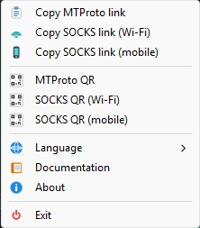

# tgrelay for desktop (Windows / Linux)

The same idea as the Android app, but for a computer: one process starts
**two proxies at once**, both using your pool of upstream proxies (HTTP CONNECT or SOCKS).

| Type | Default port | Used by |
|---|---|---|
| **MTProto** | 55055 | Telegram (desktop and phone) — proxy type "MTProto" with a secret |
| **SOCKS5** | 55056 | Telegram — proxy type "SOCKS5" (no secret, optional login/password) |

```
Telegram --> [MTProto 55055] \
                              --> HTTP CONNECT pool --> Telegram DC
Telegram --> [SOCKS5 55056]  /
```

The MTProto part decrypts the handshake (the protocol requires it: the client
encrypts with the secret). The SOCKS5 part decrypts nothing — it only relays
address and port.

**Русская версия: [README.ru.md](README.ru.md)**

## Windows: quick start

### Option A — ready-made build (no Python needed)

1. Download `tgrelay.exe` from
   [Releases](https://github.com/mikech76/tgrelay/releases).
2. Put it into any empty folder (it writes `tgrelay.txt` and the log next to itself)
   and run it.
3. On the first run it creates `tgrelay.txt` and opens it in Notepad. Fill in:
   - `PROXY=` lines — your HTTP proxies, one per line;
   - leave `SECRET` empty — it is generated automatically.
4. Save and run `tgrelay.exe` again.

A tray icon appears. Right click it:



The first lines are live status, not clickable: which protocols are up and
on which ports, how many proxies are alive, open connections, current speed
and total traffic since the start.

- **MTProto :55055**, **SOCKS5 :55056** — a submenu for each enabled protocol:
  - **Copy link — <address>** and **Show QR code — <address>** for the local
    address (the computer's address in your network);
  - the same pair for `EXTERNAL_HOST`, shown only if it is set in the config;
- **Settings** — opens `tgrelay.txt` in Notepad; save the file and close
  Notepad, and the program restarts itself with the new settings;
- **Language / Язык** — switch the interface between English and Russian
  (saved to `LANG` in `tgrelay.txt`);
- **Documentation** — opens the README for the current language;
- **About** — version, author, repository link;
- **Exit** — stop the proxies.

Running `tgrelay.exe` a second time does not start a duplicate: it just says
that the program is already running and points to the tray icon.

Autostart: put a shortcut to `tgrelay.exe` into the Startup folder
(`Win+R` → `shell:startup`).

### Option B — from source (Python)

1. Install Python 3 from <https://python.org> (check "Add python.exe to PATH").
2. Copy the `desktop` folder anywhere.
3. Double-click `start.cmd`.
4. On the first run it creates `tgrelay.txt` and opens it in Notepad. Fill in:
   - `PROXY=` lines — your HTTP proxies, one per line;
   - leave `SECRET` empty — the program will offer to generate it.
5. Save, run `start.cmd` again.

## Linux: installation

### Option A — ready-made binary (no Python needed)

```bash
chmod +x tgrelay-linux-x86_64
./tgrelay-linux-x86_64      # creates tgrelay.txt next to itself and prints what to do
nano tgrelay.txt                   # PROXY= + SECRET (or leave it empty)
./tgrelay-linux-x86_64      # run again
```

Works on Debian 10+, Ubuntu 18.04+, CentOS 8+, Fedora 28+ (x86_64).

To run it as a service, create `/etc/systemd/system/tgrelay.service`:

```ini
[Unit]
Description=tgrelay: MTProto + SOCKS5 proxy for Telegram
After=network-online.target
Wants=network-online.target

[Service]
Type=simple
User=YOURUSER
WorkingDirectory=/opt/tgrelay
ExecStart=/opt/tgrelay/tgrelay-linux-x86_64
Restart=always
RestartSec=3

[Install]
WantedBy=multi-user.target
```

```bash
sudo systemctl daemon-reload
sudo systemctl enable --now tgrelay
journalctl -u tgrelay -f
```

### Option B — from source with install-linux.sh

```bash
cd desktop
chmod +x install-linux.sh
./install-linux.sh        # creates venv, installs deps, asks for tgrelay.txt
nano tgrelay.txt                 # proxies + secret
./install-linux.sh        # second run installs the systemd service
```

Manage it:

```bash
systemctl status tgrelay
systemctl restart tgrelay
journalctl -u tgrelay -f
```

Run manually without systemd:

```bash
./venv/bin/python run_headless.py
```

### Status dot

The tray icon (and the Android app icon) is a dark blue tile with a neon paper
plane and a dot in the corner. The dot colour is the current state:

| Dot | Meaning |
|---|---|
| green | everything works, proxies are alive |
| cyan | traffic is flowing right now |
| yellow | starting, proxies are being checked |
| red | no proxy is reachable |
| grey | not running |

## Settings: one `tgrelay.txt` file

Everything is in one file — proxies, ports, external name. No environment variables.
Every block in the file is commented in both languages, English first and
Russian after it, the same order as in this documentation.

```ini
# 1. PROXIES (one per line)
PROXY=user:password@1.2.3.4:9405     # primary
PROXY=user:password@5.6.7.8:9829     # backup
# PROXY=9.9.9.9:8080                 # disabled

# 2. PORTS
PROXY_PORT=55055                     # MTProto
SOCKS_PORT=55056                     # SOCKS5
SOCKS_HOST=0.0.0.0                   # 127.0.0.1 = this PC only

# 3. MTProto SECRET
SECRET=                              # empty = generated on first run

# 4. EXTERNAL NAME (only if you forwarded the port)
EXTERNAL_HOST=                       # e.g. yourname.duckdns.org

# 5. SOCKS5 ACCESS
AUTH_BYPASS=127.0.0.1/32,192.168.0.0/24
SOCKS_USER=
SOCKS_PASS=
```

| Key | Meaning |
|---|---|
| `PROXY` | one proxy per line: `login:password@host:port`, or with a scheme — `http://`, `https://`, `socks5://`, `socks://` (5 by default), `socks4://`; without a scheme the type is detected automatically |
| `PROXY_PORT` | MTProto port (default 55055); comment the line out, set `off` or leave it empty to disable MTProto |
| `SOCKS_PORT` | SOCKS5 port (default 55056); same — disables SOCKS5 entirely |
| `SOCKS_HOST` | SOCKS5 listen address |
| `SECRET` | MTProto secret; if empty, it is generated and written here |
| `LANG` | interface language: `en` or `ru`; empty = system language |
| `EXTERNAL_HOST` | DDNS name or external IP used in links |
| `AUTH_BYPASS` | networks allowed to use SOCKS5 without a password |
| `SOCKS_USER` / `SOCKS_PASS` | login/password for everyone else |

The old one-line format is still supported:
`PROXIES=user:pass@1.2.3.4:9405;5.6.7.8:8080`.

A protocol with a disabled port does not start at all, and its tray items
(copy link, QR) disappear from the menu. If both are disabled, the program
says there is nothing to start.

An old config from previous versions (the file used to be named `.env`) is
picked up and renamed automatically on the first run.

### Interface language

`LANG=en` or `LANG=ru` in `tgrelay.txt`, or leave it empty — the system language is
used (Russian Windows → Russian, everything else → English). The tray menu
item **Language / Язык** switches it instantly and writes the value into `tgrelay.txt`.

The very first message (when `tgrelay.txt` is created) is shown in both languages,
because the language is not known yet. Everything after that follows `LANG`.

### Comments in `tgrelay.txt`

```ini
# a whole line is a comment
SECRET=9d4e215aeba83fe52b0764a4d1e5bdd3   # trailing comment is ignored

PROXY=user:pass@1.2.3.4:9405        # this one is enabled
# PROXY=user:pass@9.9.9.9:1234      # this one is disabled
```

If you keep several proxies in a single `PROXIES=` line, disable one with `#`
immediately after `;` — without a space:

```ini
PROXIES=user:pass@1.2.3.4:9405;#user:pass@9.9.9.9:1234;user:pass@5.6.7.8:8080
```

A `#` **preceded by a space** cuts the rest of the line, so do not put a space
before it when disabling a single entry inside a list.

### MTProto secret

The secret is 32 hex characters (16 bytes). It is not a password but key
material: anyone who knows it can use your proxy.

If `SECRET` is empty, on the first launch the program asks (the wording
follows `LANG` / the system language):

```
SECRET is not set in tgrelay.txt for the MTProto proxy.
Generate a new key? [Y/n]:
```

Answer `Y` (or press Enter) and the key is generated and written into `tgrelay.txt`.
If you answer `n`, the program stops so you can set your own value.

Under a GUI/service (no console) the key is generated automatically and written
to `tgrelay.txt`.

## Connecting Telegram

**Computer (Telegram Desktop):**

- MTProto: `tg://proxy?server=127.0.0.1&port=55055&secret=<SECRET>`
- SOCKS5: `tg://socks?server=127.0.0.1&port=55056` (if `SOCKS_USER` is empty)

The tray always builds links with the correct address and secret.

**Phone in the same Wi-Fi:**

Server `192.168.x.x` (the computer's address), port `55055` (MTProto with the
secret) or `55056` (SOCKS5). If `SOCKS_USER` is set, the password is required —
`AUTH_BYPASS` only covers addresses from the list.

## Access from other networks (optional)

By default everything works only inside the local network. To connect from
outside (for example, Telegram Desktop on another computer), two things are needed.

**1. Port forwarding on the router.** Open the router's web interface and find
"Port Forwarding" / "Virtual Servers":

| Field | Value |
|---|---|
| External port | 55055 (MTProto) and/or 55056 (SOCKS5) |
| Internal IP | the computer's LAN address, e.g. `192.168.1.10` |
| Internal port | the same |
| Protocol | TCP |

Pin the computer's address in DHCP, otherwise it changes after a reboot.

**2. DDNS name.** A home IP changes, so dynamic DNS is used:

- <https://www.duckdns.org> — free, gives a name like `yourname.duckdns.org`;
- <https://www.noip.com> — free tier as well.

Put the name into `tgrelay.txt`:

```ini
EXTERNAL_HOST=yourname.duckdns.org
```

After a restart the tray links use this address.

**Before exposing anything to the internet:**

- set `SOCKS_USER` and `SOCKS_PASS`, otherwise your SOCKS5 becomes an open proxy
  for the whole internet;
- keep in mind that an MTProto proxy without fake-TLS (a secret without the `ee`
  prefix) is recognisable by DPI systems;
- never publish your secret or proxy list.

## Limitations

- Telegram calls do not work through a proxy.
- The MTProto part does not implement fake-TLS (`ee`), so traffic is not disguised
  as HTTPS.
- Speed is limited by your proxies.
- On some mobile carriers DPI drops HTTP CONNECT to Telegram addresses.

## Troubleshooting

Windows log: `tgrelay.log` next to `tgrelay.exe` (or next to the scripts
when running from source).
Linux log: `journalctl -u tgrelay -f` (`tgrelay.log` next to the binary
without systemd).

Check the proxy pool without starting the server:

```bash
python socks5_to_http.py --test
```
