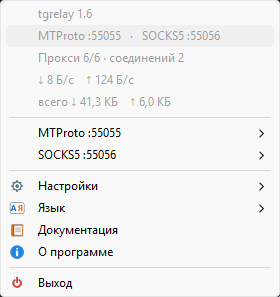

# tgrelay для компьютера (Windows / Linux)

Небольшая программа на Go (4,9 МБ, ~17 МБ памяти): тот же принцип, что и в
Android-версии, но для десктопа. Один процесс поднимает
**два прокси одновременно** — MTProto и SOCKS5.

По умолчанию оба ходят через ваш пул апстрим-прокси (HTTP CONNECT или SOCKS).
Без строк `PROXY=` они работают напрямую: программа сама выходит в интернет
(см. [Режим без прокси](#режим-без-прокси-direct)).

| Тип | Порт по умолчанию | Кому |
|---|---|---|
| **MTProto** | 55055 | Telegram (десктоп и телефон) — тип «MTProto» с секретом |
| **SOCKS5** | 55056 | Telegram — тип «SOCKS5» (без секрета, с логином/паролем) |

```
Telegram --> [MTProto 55055] --\
                               +--> пул апстрим-прокси --> DC Telegram
Telegram --> [SOCKS5 55056]  --/

без строк PROXY=: MTProto 55055 и SOCKS5 55056 --> интернет напрямую
```

MTProto-часть расшифровывает handshake (так устроен протокол: клиент шифрует
секретом). SOCKS5-часть не расшифровывает ничего — передаёт только адрес и порт.

**English version: [README.md](README.md)**

## Windows: быстрый старт

### Вариант А — готовая сборка (ставить ничего не нужно)

1. Скачайте `tgrelay.exe` из
   [Releases](https://github.com/mikech76/tgrelay/releases).
2. Положите в любую пустую папку (туда же запишутся `tgrelay.txt` и лог) и запустите.
3. При первом запуске он создаст `tgrelay.txt` и откроет его в Блокноте. Впишите:
   - строки `PROXY=` — ваши HTTP-прокси, по одной на строку (совсем без них —
     режим direct);
   - `SECRET` оставьте пустым — ключ сгенерируется и запишется в файл.
4. Сохраните и запустите `tgrelay.exe` снова.

В трее появится иконка. Правый клик:



Первые строки — живое состояние (не кликаются): какие протоколы подняты и
на каких портах, сколько прокси живо, открытые соединения, текущая скорость и
сколько всего прошло с момента запуска.

- **MTProto :55055**, **SOCKS5 :55056** — подменю для каждого включённого
  протокола:
  - **Копировать ссылку — <адрес>** и **Показать QR-код — <адрес>** для
    локального адреса (адрес компьютера в вашей сети);
  - то же самое для `EXTERNAL_HOST`, если он задан в конфиге;
  - в трее используется первый ключ/логин; `tgrelay links` печатает ссылку
    для каждого ключа и каждой учётной записи SOCKS5;
- **Настройки** — подменю:
  - **Редактировать конфиг** — открывает `tgrelay.txt` в Блокноте; сохраните
    файл и закройте Блокнот — программа сама перезапустится;
  - **Автозагрузка** — галочка, добавляет или убирает программу из
    `HKCU\...\Run`; искать папку «Автозагрузка» больше не нужно;
  - **Перечитать конфиг** — перечитывает файл и перезапускает всё сразу:
    прокси проверяются заново, порты открываются заново;
- **Язык / Language** — переключение интерфейса EN/RU (пишется в `LANG`;
  у headless-сборки язык задаётся только в `tgrelay.txt`);
- **Документация** — открывает README на текущем языке;
- **О программе** — версия, автор, ссылка на репозиторий;
- **Выход** — остановить прокси.

Повторный запуск `tgrelay.exe` не создаёт второй экземпляр: программа
сообщит, что уже работает, и покажет на иконку в трее.

Автозапуск: правый клик по иконке → **Настройки** → **Автозагрузка**
(добавляет программу в `HKCU\Software\Microsoft\Windows\CurrentVersion\Run`).
Снятая галочка убирает её оттуда.

### Вариант Б — из исходников (Go 1.22+)

```bat
cd go
go build -trimpath -ldflags "-s -w -H=windowsgui" -o tgrelay.exe .
```

Или в Docker, без установки Go:

```bat
cd go
docker run --rm -v "%CD%:/src" -w /src golang:1.23-alpine sh build.sh
```

Exe самодостаточный: рантайм ставить не нужно, никаких DLL рядом класть не надо.

## Linux: установка

### Вариант А — готовый бинарник (ставить ничего не нужно)

```bash
chmod +x tgrelay-linux
./tgrelay-linux            # создаст tgrelay.txt рядом и подскажет, что делать
nano tgrelay.txt           # PROXY= + SECRET (или совсем без PROXY= — режим direct)
./tgrelay-linux            # запуск заново
```

Работает на Debian 10+, Ubuntu 18.04+, CentOS 8+, Fedora 28+ (x86_64).

Как служба — создайте `/etc/systemd/system/tgrelay.service`:

```ini
[Unit]
Description=tgrelay: MTProto + SOCKS5 proxy for Telegram
After=network-online.target
Wants=network-online.target

[Service]
Type=simple
User=YOURUSER
WorkingDirectory=/opt/tgrelay
ExecStart=/opt/tgrelay/tgrelay
Restart=always
RestartSec=3

[Install]
WantedBy=multi-user.target
```

```bash
sudo systemctl daemon-reload
sudo systemctl enable --now tgrelay
journalctl -u tgrelay -f
```

### Вариант Б — из исходников (Go)

```bash
cd go
sh build.sh              # соберёт dist/tgrelay-linux и dist/tgrelay.exe
sudo install -m 755 dist/tgrelay-linux /opt/tgrelay/tgrelay
```

Готовый systemd-юнит — в предыдущем разделе, поменять нужно только `ExecStart`.
Linux-сборка намеренно без трея: печатает ссылки и работает на переднем плане,
процессом управляет systemd.

### Точка статуса

Иконка в трее (и значок Android-приложения) — тёмно-синий квадрат с неоновым
самолётиком и точкой в углу. Цвет точки — текущее состояние:

| Точка | Что означает |
|---|---|
| зелёная | всё работает, прокси живы |
| голубая | прямо сейчас идёт трафик |
| жёлтая | запуск, прокси проверяются |
| красная | ни один прокси не отвечает |
| серая | не запущено |

## Командная строка

Один и тот же бинарник — и сервер, и средство управления. На Linux-сервере
сервер живёт под systemd, остальные команды общаются с ним через локальный
канал управления (`tgrelay.ctl` рядом с конфигом, только 127.0.0.1).

```bash
tgrelay                 # запуск (Windows — трей, Linux — передний план)
tgrelay run             # то же самое, явно
tgrelay status          # pid, режим, порты, uptime, соединения, трафик, пользователи
tgrelay links           # ссылка для каждого ключа MTProto и каждой учётной записи SOCKS5
tgrelay reload          # перечитать конфиг и перезапустить прокси и порты на месте
tgrelay stop            # аккуратно остановить
tgrelay log -n 50       # последние строки tgrelay.log
tgrelay log -f          # следить за логом (как tail -f)
tgrelay config          # путь к конфигу
tgrelay config edit     # открыть в $EDITOR (nano/vi) или Блокноте
tgrelay check           # проверить конфиг и доступность прокси / прямого выхода
tgrelay version
```

`--config путь` — другой файл конфигурации, `--headless` (`-headless`) —
сервер без трея (то же, что на Linux).

Под systemd обычный сценарий такой:

```bash
sudo systemctl restart tgrelay     # полный перезапуск
sudo tgrelay reload                # то же, но без пересоздания процесса
sudo tgrelay status
```

## Несколько человек, несколько ключей

Каждая строка `SECRET=` — отдельный ключ MTProto, каждая пара
`SOCKS_USER`/`SOCKS_PASS` — отдельная учётная запись SOCKS5:

```ini
SECRET=aaaaaaaaaaaaaaaaaaaaaaaaaaaaaaaa   # для Алисы
SECRET=bbbbbbbbbbbbbbbbbbbbbbbbbbbbbbbb   # для Боба

SOCKS_USER=alice
SOCKS_PASS=alice-password
SOCKS_USER=bob
SOCKS_PASS=bob-password
```

- MTProto принимает любой из перечисленных секретов, SOCKS5 — любую пару.
  Ключ номер `i` виден в `status` как `mtproto#i`, учётные записи SOCKS5 —
  под своими логинами.
- `tgrelay links` печатает готовую ссылку для **каждого** ключа и каждой
  учётной записи; в трее показывается только первый ключ/логин, поэтому при
  раздаче нескольких ключей удобнее командная строка.
- Чтобы отозвать доступ, удалите строку и нажмите **Перечитать конфиг**
  (или `tgrelay reload`): процесс продолжает работать, удалённый ключ
  перестаёт пускать сразу.
- `tgrelay status` показывает трафик по каждому ключу/логину — видно, кто
  сколько расходует.

Ключ — 32 hex-символа (16 байт). Сгенерировать свой:

```bash
openssl rand -hex 16          # Linux, macOS
```

```powershell
-join ((1..16) | ForEach-Object { '{0:x2}' -f (Get-Random -Maximum 256) })
```

## Режим без прокси (direct)

Если в конфиге нет ни одной строки `PROXY=`, программа не использует
апстрим-прокси вообще: подключается к интернету напрямую. Так получается
самостоятельный прокси для VPS за рубежом — клиенты ходят на ваш сервер, а он
сам общается с Telegram (или с любым сайтом, если речь про SOCKS5).

```ini
# строк PROXY= просто нет
SECRET=9d4e215aeba83fe52b0764a4d1e5bdd3
PROXY_PORT=55055
SOCKS_PORT=55056
SOCKS_HOST=0.0.0.0        # чтобы SOCKS5 принимал и другие машины
```

- SOCKS5 в этом режиме работает для любых сайтов, без ограничений.
- MTProto требует, чтобы Telegram был доступен с самого сервера. На обычном
  VPS за рубежом — да; внутри страны, где Telegram заблокирован — нет.
- Если позже добавить строки `PROXY=` и нажать **Перечитать конфиг**,
  программа вернётся к работе через пул.

## Настройки: один файл `tgrelay.txt`

Всё в одном файле — прокси, порты, внешнее имя. Переменные окружения не нужны.
Каждый блок в файле подписан на двух языках: сначала английский, потом
русский — в том же порядке, что и в документации.

```ini
# 1. ПРОКСИ (по одному на строку; совсем без PROXY= — режим direct)
PROXY=user:password@1.2.3.4:9405     # основной
PROXY=user:password@5.6.7.8:9829     # запасной
# PROXY=9.9.9.9:8080                 # выключен

# 2. ПОРТЫ
PROXY_PORT=55055                     # MTProto
SOCKS_PORT=55056                     # SOCKS5
SOCKS_HOST=0.0.0.0                   # 127.0.0.1 = только этот ПК

# 3. СЕКРЕТЫ MTProto (по одному на человека; каждый SECRET= — отдельный ключ)
SECRET=                              # пусто = сгенерируется и запишется при первом запуске
# SECRET=bbbbbbbbbbbbbbbbbbbbbbbbbbbbbbbb   # второй ключ, для Боба

# 4. ВНЕШНЕЕ ИМЯ (только если пробросили порт)
EXTERNAL_HOST=                       # например yourname.duckdns.org

# 5. ДОСТУП К SOCKS5
AUTH_BYPASS=127.0.0.1/32,192.168.0.0/24
SOCKS_USER=                          # первая учётная запись
SOCKS_PASS=
# SOCKS_USER=bob                     # вторая учётная запись
# SOCKS_PASS=bob-password
```

| Ключ | Что задаёт |
|---|---|
| `PROXY` | один прокси на строку: `логин:пароль@хост:порт` или со схемой — `http://`, `https://`, `socks5://`, `socks://` (по умолчанию 5), `socks4://`; без схемы тип определяется автоматически. Совсем без строк `PROXY=` — режим direct |
| `PROXY_PORT` | порт MTProto (по умолчанию 55055); закомментируйте строку, поставьте `off` или оставьте пусто, чтобы выключить MTProto |
| `SOCKS_PORT` | порт SOCKS5 (по умолчанию 55056); так же выключается SOCKS5 |
| `SOCKS_HOST` | адрес прослушивания SOCKS5 |
| `SECRET` | секрет MTProto, 32 hex-символа; **повторите строку** для нескольких ключей. Если пусто — ключ сгенерируется и запишется сюда |
| `LANG` | язык интерфейса: `en` или `ru`; пусто = язык системы |
| `EXTERNAL_HOST` | DDNS-имя или внешний IP для ссылок |
| `AUTH_BYPASS` | сети, которым SOCKS5 не требует пароля |
| `SOCKS_USER` / `SOCKS_PASS` | логин и пароль для всех остальных; **повторите пару** для нескольких учётных записей |

Старый формат одной строкой тоже поддерживается:
`PROXIES=user:pass@1.2.3.4:9405;5.6.7.8:8080`.

Протокол с выключенным портом не поднимается вообще, а его пункты
(копировать ссылку, QR) исчезают из меню трея. Если выключены оба,
программа скажет, что запускать нечего.

### Язык интерфейса

`LANG=en` или `LANG=ru` в `tgrelay.txt`; пусто — берётся язык системы (русская
Windows → русский, остальные → английский). Пункт меню трея
**Язык / Language** переключает на лету и сразу пишет значение в `tgrelay.txt`.

Самое первое сообщение (при создании `tgrelay.txt`) показывается на двух языках —
язык ещё неизвестен. Всё остальное идёт по `LANG`.

### Комментарии в `tgrelay.txt`

```ini
# целая строка — комментарий
SECRET=9d4e215aeba83fe52b0764a4d1e5bdd3   # хвост строки игнорируется

PROXY=user:pass@1.2.3.4:9405        # включён
# PROXY=user:pass@9.9.9.9:1234      # выключен
```

Если держите несколько прокси в одной строке `PROXIES=`, отключайте один
решёткой сразу после `;` — без пробела:

```ini
PROXIES=user:pass@1.2.3.4:9405;#user:pass@9.9.9.9:1234;user:pass@5.6.7.8:8080
```

`#`, **перед которым стоит пробел**, обрезает всю строку — поэтому при
отключении одного элемента списка пробел ставить нельзя.

### Секрет MTProto

Секрет — 32 hex-символа (16 байт). Это не пароль, а ключ: кто его знает,
тот может пользоваться вашим прокси.

Если `SECRET` пустой, при первом запуске ключ генерируется, записывается в
`tgrelay.txt` и печатается в лог:

```
SECRET сгенерирован и записан в конфиг: 9d4e215aeba83fe52b0764a4d1e5bdd3
```

Дальше ключ не меняется: перезапуски и **Перечитать конфиг** его сохраняют,
поэтому ссылка для Telegram остаётся прежней. Чтобы дать доступ ещё кому-то,
добавьте вторую строку `SECRET=`
(см. [Несколько человек, несколько ключей](#несколько-человек-несколько-ключей)).

## Подключение Telegram

**Компьютер (Telegram Desktop):**

- MTProto: `tg://proxy?server=127.0.0.1&port=55055&secret=<SECRET>`
- SOCKS5: `tg://socks?server=127.0.0.1&port=55056` (если `SOCKS_USER` пуст)

Ссылки с правильными адресами и секретом всегда можно взять в трее.

Если строк `SECRET=` несколько, у каждого человека своя ссылка: выполните
`tgrelay links` и раздайте `mtproto #1`, `mtproto #2` и так далее.

**Телефон в той же Wi-Fi:**

Сервер `192.168.x.x` (адрес компьютера), порт `55055` (MTProto, с секретом)
или `55056` (SOCKS5). Для SOCKS5, если задан пароль, он обязателен —
`AUTH_BYPASS` действует только на адреса из списка.

## Доступ из других сетей (необязательно)

По умолчанию всё работает только в локальной сети. Если нужно подключаться
снаружи (например, Telegram Desktop с другого компьютера), нужны две вещи.

**1. Проброс порта на роутере.** В веб-интерфейсе роутера найдите
«Port Forwarding» / «Виртуальные серверы» и создайте правило:

| Параметр | Значение |
|---|---|
| Внешний порт | 55055 (MTProto) и/или 55056 (SOCKS5) |
| Внутренний IP | локальный адрес компьютера, например `192.168.1.10` |
| Внутренний порт | тот же |
| Протокол | TCP |

Адрес компьютера лучше закрепить в DHCP, иначе после перезагрузки он изменится.

**2. DDNS-имя.** Домашний IP меняется, поэтому используют динамический DNS:

- <https://www.duckdns.org> — бесплатно, даёт имя вида `yourname.duckdns.org`;
- <https://www.noip.com> — тоже бесплатный тариф.

Выбранное имя впишите в `tgrelay.txt`:

```ini
EXTERNAL_HOST=yourname.duckdns.org
```

После перезапуска ссылки в трее будут уже с этим адресом.

**Обязательно перед открытием наружу:**

- задайте `SOCKS_USER` и `SOCKS_PASS` — иначе ваш SOCKS5 станет открытым
  прокси для всего интернета;
- помните, что MTProto-прокси без fake-TLS (секрет без префикса `ee`)
  распознаётся системами DPI;
- не публикуйте секрет и список прокси.

## Ограничения

- Звонки Telegram через прокси не работают.
- MTProto-часть не реализует fake-TLS (`ee`), поэтому трафик не маскируется
  под HTTPS.
- Скорость ограничена вашими прокси.
- На некоторых мобильных операторах DPI обрывает HTTP CONNECT к адресам
  Telegram.

## Диагностика

Лог Windows: `tgrelay.log` рядом с `tgrelay.exe` (или рядом со скриптами,
если запускаете из исходников).
Лог Linux: `journalctl -u tgrelay -f` (без systemd — `tgrelay.log` рядом
с бинарником).

Пул проверяется сам: health-check при старте и раз в минуту, а в трее видно
`Прокси N/M` — мёртвые пропускаются при следующем подключении.
